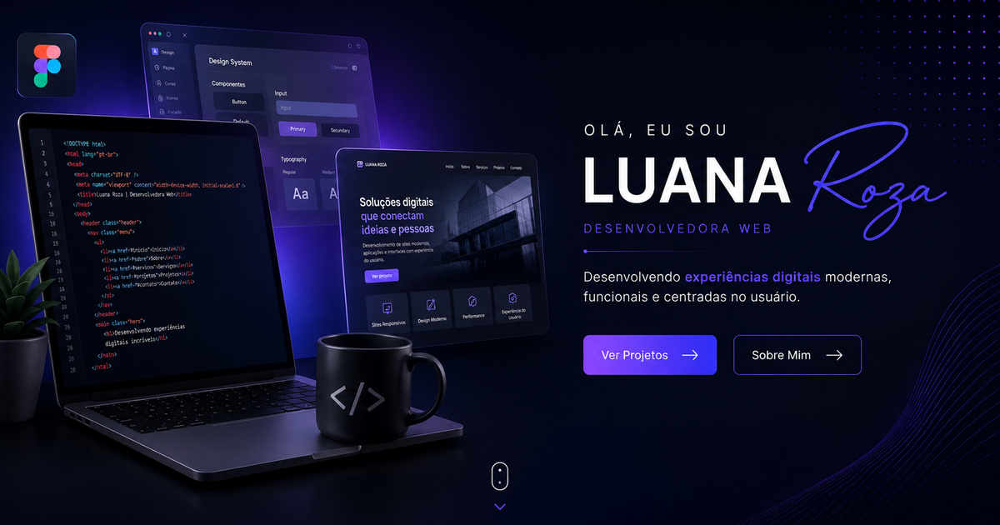

# Luana Roza — Digital Experiences

Portfólio profissional desenvolvido do zero, sem frameworks: HTML, CSS e
JavaScript puros, com formulário de contato funcional e uma página de
orçamento interativa.

🔗 **[Ver o site](https://luh095.github.io/Luana-Roza---Digital-Experiences/)**



---

## Sobre o projeto

Mais do que uma vitrine, este projeto foi meu laboratório de estudos em
desenvolvimento web. Cada seção virou um exercício prático de algo que eu
queria dominar melhor: organização de código, responsividade pensada desde
o mobile, animação com propósito e integração de front com back.

Tudo foi construído manualmente, sem bibliotecas de UI, framework ou etapa
de build — a ideia era entender o que acontece por baixo antes de usar
ferramentas que abstraem isso.

---

## Funcionalidades

**Hero** — apresentação com efeito de digitação, cards flutuantes de
destaque e parallax 3D que acompanha o mouse.

**Carrossel Cover Flow** — componente construído do zero com navegação por
botões, teclado e swipe no celular, indicadores dinâmicos, autoplay com
pausa no hover e seis estados de posicionamento dos cards.

**Minha Jornada** — timeline vertical com marcos da trajetória, métricas e
área de apresentação pessoal com as tecnologias que utilizo.

**Serviços** — grid de 4 cards com animação de entrada em cascata via
Intersection Observer e efeito de brilho que segue o cursor.

**Projetos** — galeria com imagem, categoria, descrição, stack e links
para o repositório de cada projeto.

**Experiência** — timeline alternada entre esquerda e direita, cobrindo de
2022 até a atuação como Programadora Júnior.

**Contato** — formulário com validação de e-mail em tempo real, feedback
visual de erro e sucesso, proteção anti-spam por honeypot e envio
assíncrono via Web3Forms (sem necessidade de servidor próprio).

**Página de Preços** — três pacotes fixos mais um montador de orçamento
sob medida: o visitante marca os serviços desejados, vê o total calculado
na hora e é levado ao formulário de contato já preenchido com o resumo da
escolha, via parâmetros na URL.

---

## Tecnologias

| Camada | O que foi usado |
|---|---|
| Estrutura | HTML5 semântico |
| Estilo | CSS3 — custom properties, Grid, Flexbox, `clamp()`, glassmorphism |
| Interação | JavaScript (ES6+), sem framework ou dependências |
| Animação | Intersection Observer, CSS keyframes, `requestAnimationFrame` |
| Imagens | WebP com fallback PNG via `<picture>` |
| Formulário | Web3Forms |
| Tipografia | Space Grotesk + Inter (Google Fonts) |
| Ícones | Font Awesome 6 |

São 17 arquivos CSS e 12 arquivos JavaScript, sem nenhuma dependência
instalada: não há `package.json`, bundler ou etapa de build.

---

## Performance

- Todas as imagens servidas em **WebP**, com PNG como fallback — de 5,1 MB
  para 252 KB no total, cerca de 95% a menos
- `width` e `height` declarados em cada imagem, evitando deslocamento de
  layout durante o carregamento (CLS)
- `fetchpriority="high"` na imagem da dobra e `loading="lazy"` nas demais
- Meta tags Open Graph e favicon configurados para o compartilhamento em
  redes sociais

---

## Acessibilidade e boas práticas

- Marcação semântica, com `aria-label` em links de ícone e `aria-hidden`
  nos elementos puramente decorativos
- Suporte a `prefers-reduced-motion`: todas as animações são desligadas
  para quem configurou isso no sistema
- Contorno de foco visível na navegação por teclado
- `rel="noopener noreferrer"` em todos os links externos
- Layout responsivo em três faixas — desktop, tablet e celular

---

## Estrutura

```
.
├── index.html           # Página principal
├── precos.html          # Pacotes e montador de orçamento
├── assets/              # Imagens
├── css/                 # Um arquivo por seção + variáveis e reset
└── js/                  # Um arquivo por comportamento
```

O CSS e o JavaScript são separados por seção em vez de concentrados em um
arquivo único — `hero.css` e `hero`-relacionados, `carousel.css` e
`carousel.js`, e assim por diante. As cores, fontes, espaçamentos e raios
ficam centralizados em `css/variables.css` como custom properties.

---

## Rodando localmente

```bash
git clone https://github.com/Luh095/Luana-Roza---Digital-Experiences.git
cd Luana-Roza---Digital-Experiences
```

Abrir o `index.html` direto no navegador já funciona. Para que o
preenchimento automático do formulário a partir da página de preços
funcione como em produção, prefira um servidor local:

```bash
python3 -m http.server 8000
# acesse http://localhost:8000
```

O formulário de contato usa uma Access Key do
[Web3Forms](https://web3forms.com) — gratuita — no campo oculto
`access_key` do `index.html`. A chave é pública por natureza, já que o
envio acontece no navegador; quem clonar o repositório deve gerar a sua
própria para receber as mensagens no próprio e-mail.

---

## Contato

**Luana Roza** — Desenvolvedora Web

[](https://www.linkedin.com/in/luanarozadeoliveira/)
[](https://instagram.com/dev.luanaroza)
[](mailto:desenvolvedoraluana@gmail.com)
